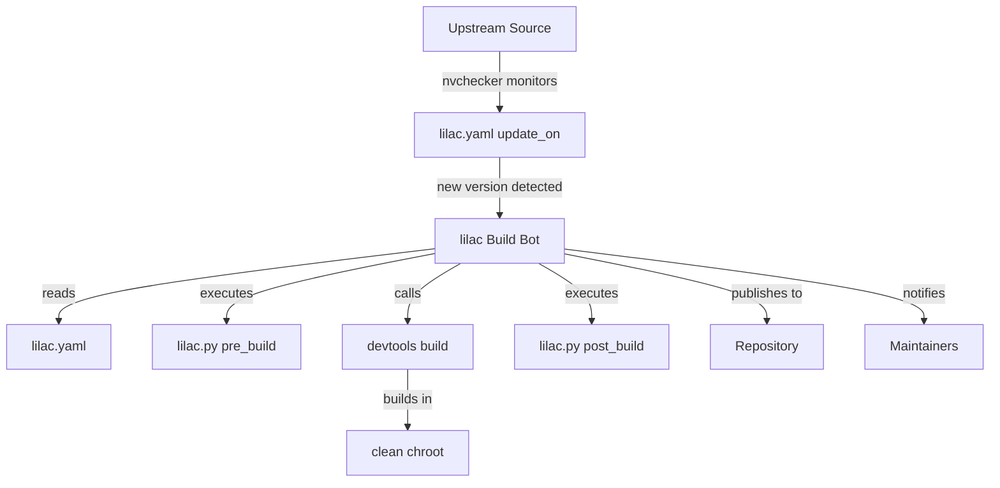

# Lilac Package Management

## Overview

Lilac is an automated packaging tool for Arch Linux that manages the entire package lifecycle: detecting updates, building packages in clean chroots, handling dependencies, and publishing to repositories. It integrates with nvchecker for version monitoring and uses devtools for isolated builds.

**Core Components:**
- **lilac**: Main build bot that orchestrates the build process
- **nvchecker**: Version checker that monitors upstream sources for updates
- **lilac.yaml**: Package-specific configuration defining build parameters and update sources
- **lilac.py**: Optional Python script for custom pre/post-build logic

## When to Use

Use this skill when:
- Setting up an automated Arch Linux package repository
- Creating or maintaining packages for archlinuxcn or similar repos
- Configuring automatic rebuilds when dependencies update
- Managing complex package build workflows with custom logic
- Migrating packages from manual to automated builds

**Prerequisite:** Valid PKGBUILD files. Use `archlinux-pkgbuild` to create or validate PKGBUILDs before configuring them for lilac automation.

**Do NOT use for:**
- One-off package builds (use `makepkg` directly)
- Standard Arch official packaging (use Arch Linux packaging guidelines)
- Package installation on end-user systems (use `pacman`)
- Creating initial PKGBUILDs (use `archlinux-pkgbuild` first)

## Architecture



## Quick Start

### 1. Installation

```bash
# Install lilac and dependencies from archlinuxcn
pacman -Syu lilac-git devtools-archlinuxcn python-psycopg2

# Optional: PostgreSQL for build logs
pacman -S postgresql
```

### 2. User Setup

```bash
# Create dedicated build user
useradd -m -g pkg lilac

# Login as lilac user
machinectl shell lilac@

# Configure git
git config --global user.name "Lilac Bot"
git config --global user.email "lilac@example.org"
git config --global maintenance.autoDetach false

# Generate GPG key for package signing
gpg --gen-key

# Generate SSH key for git operations
ssh-keygen -t ed25519
```

### 3. Repository Structure

```
myrepo/
├── pkgbase1/
│   ├── lilac.yaml      # Required: package configuration
│   ├── PKGBUILD        # Required: package build script
│   └── lilac.py        # Optional: custom build logic
├── pkgbase2/
│   ├── lilac.yaml
│   └── PKGBUILD
└── .git/               # Git repository root
```

### 4. Minimal lilac.yaml

```yaml
# Simple package that updates from GitHub releases
maintainers:
  - github: yourusername
    email: Your Name <you@example.org>

build_prefix: extra-x86_64

update_on:
  - source: github
    github: owner/repo
    use_max_tag: true
```

### 5. Configuration File

Create `~/.lilac/config.toml`:

```toml
[envvars]
TZ = "Asia/Shanghai"

[repository]
name = "myrepo"
email = "repo@example.org"
repodir = "/home/lilac/myrepo"
destdir = "/home/lilac/packages"

[lilac]
name = "lilac"
email = "lilac@example.org"
master = "Admin <admin@example.org>"
rebuild_failed_pkgs = false
git_push = false
send_email = false
max_concurrency = 2

[bindmounts]
"~/.cache/pip" = "/build/.cache/pip"
"~/.cargo" = "/build/.cargo"
```

### 6. First Run

```bash
# Setup database (optional)
psql -f /usr/share/doc/lilac/dbsetup.sql

# Run lilac
lilac

# Check logs
ls ~/.lilac/log/
```

## Common Workflows

### Adding a New Package

```bash
cd ~/myrepo
mkdir newpkg && cd newpkg

# Create PKGBUILD (standard Arch format)
# Use `archlinux-pkgbuild` skill for PKGBUILD creation and validation
cat > PKGBUILD << 'EOF'
pkgname=newpkg
pkgver=1.0.0
pkgrel=1
pkgdesc="Description"
arch=('x86_64')
url="https://example.com"
license=('MIT')
depends=('dependency1')
source=("$pkgname-$pkgver.tar.gz::https://example.com/download/v$pkgver.tar.gz")
sha256sums=('SKIP')

build() {
  cd "$pkgname-$pkgver"
  make
}

package() {
  cd "$pkgname-$pkgver"
  make DESTDIR="$pkgdir" install
}
EOF

# Create lilac.yaml
cat > lilac.yaml << 'EOF'
maintainers:
  - github: yourusername

build_prefix: extra-x86_64

update_on:
  - source: github
    github: owner/newpkg
    use_max_tag: true
EOF

# Test build manually first
extra-x86_64-build

# Commit and push
git add .
git commit -m "addpkg: newpkg"
git push
```

### VCS Package (Git Version)

```yaml
# lilac.yaml for VCS package
maintainers:
  - github: yourusername

build_prefix: extra-x86_64

update_on:
  - source: github
    github: neovim/neovim
    branch: master
    lilac_throttle: 1d  # Don't rebuild more than once per day

repo_depends:
  - tree-sitter-git  # Dependencies within same repo
```

```python
# lilac.py for VCS package
from lilac2.api import *

def pre_build():
    # Update version from git
    vcs_update()

def post_build():
    # Push to AUR if configured
    git_pkgbuild_commit()
    update_aur_repo()
```

### Python Package from PyPI

```python
# lilac.py for PyPI package
from lilac2.api import *

def pre_build():
    pypi_pre_build(
        pypi_name="requests",  # PyPI package name
        depends=["python-urllib3", "python-chardet"],
        makedepends=["python-setuptools"],
        optdepends=["python-pysocks: for socks support"],
        check="python -m pytest tests/",
    )

def post_build():
    pypi_post_build()
```

## Reference

### Required Files per Package

| File | Required | Purpose |
|------|----------|---------|
| `PKGBUILD` | Yes | Standard Arch package build script |
| `lilac.yaml` | Yes | Lilac configuration and update sources |
| `lilac.py` | No | Custom Python build hooks |

### Build Prefixes

| Prefix | Architecture | Use Case |
|--------|--------------|----------|
| `extra-x86_64` | x86_64 | Standard 64-bit packages |
| `multilib` | x86_64 | 32-bit compatibility libraries |
| `archlinuxcn-x86_64` | x86_64 | archlinuxcn-specific builds |
| `extra-aarch64` | ARM64 | ARM 64-bit packages |

### Key Commands

| Command | Purpose |
|---------|---------|
| `lilac` | Run the build bot |
| `nvchecker -c nvchecker.toml` | Check versions only |
| `nvcmp` | Compare old/new versions |
| `extra-x86_64-build` | Manual build in clean chroot |
| `arch-nspawn /var/lib/archbuild/extra-x86_64/root` | Enter build chroot |

## Common Mistakes

| Mistake | Solution |
|---------|----------|
| `lilac.yaml` syntax error | Use YAML validator; check indentation |
| Missing `build_prefix` | Required field; use `extra-x86_64` |
| Wrong GitHub source | Use `owner/repo` format, not full URL |
| GPG signing fails | Ensure GPG key generated and `PACKAGER` set |
| SSH key not working | Configure in `~/.ssh/config` with `ControlMaster` |
| Permission denied | User must be in `pkg` group; use `machinectl` not `su` |
| Git push fails | Set `git_push = false` initially for testing |

## Sub-Skills

**REQUIRED:**
- `lilac/yaml-config` - Complete lilac.yaml reference
- `lilac/nvchecker-config` - nvchecker source configuration
- `lilac/py-api` - Python scripting and API reference

**REQUIRED BACKGROUND:**
- `archlinux-pkgbuild` - PKGBUILD creation, validation with namcap, and clean chroot builds. A valid PKGBUILD is the prerequisite for lilac automation.

## Troubleshooting

### Build Fails in Chroot

```bash
# Enter chroot manually to debug
arch-nspawn /var/lib/archbuild/extra-x86_64/root

# Check if dependencies are available
pacman -Si dependency-name
```

### Version Not Detected

```bash
# Test nvchecker manually
cd ~/.lilac
nvchecker -c nvchecker.toml

# Check version record files
cat new_ver.json
cat old_ver.json
```

### Git Issues

```bash
# Fix git maintenance issue
git config --global maintenance.autoDetach false

# Check SSH access to AUR
ssh aur@aur.archlinux.org
```

## Resources

- **Documentation**: https://lilac.readthedocs.io/
- **nvchecker Docs**: https://nvchecker.readthedocs.io/
- **lilac.yaml Schema**: https://archlinuxcn.github.io/lilac/
- **archlinuxcn Repo**: https://github.com/archlinuxcn/repo
