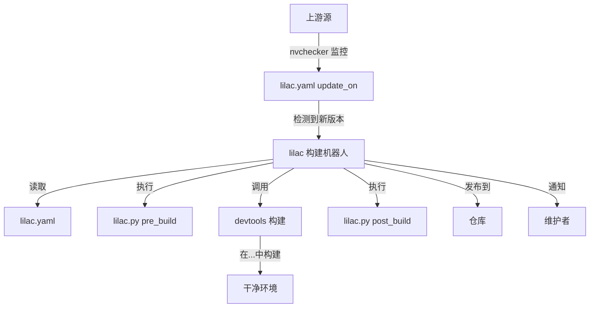

# Lilac 软件包管理

## 概述

Lilac 是一个 Arch Linux 自动化打包工具，管理软件包的完整生命周期：检测更新、在干净环境中构建、处理依赖关系并发布到仓库。它与 nvchecker 集成进行版本监控，并使用 devtools 进行隔离构建。

**核心组件：**
- **lilac**: 主构建机器人，协调构建流程
- **nvchecker**: 版本检查器，监控上游源的更新
- **lilac.yaml**: 软件包特定的配置，定义构建参数和更新源
- **lilac.py**: 可选的 Python 脚本，用于自定义构建前/后逻辑

## 何时使用

在以下情况使用本技能：
- 设置自动化 Arch Linux 软件包仓库
- 为 archlinuxcn 或类似仓库创建或维护软件包
- 配置依赖更新时自动重建
- 使用自定义逻辑管理复杂的软件包构建工作流
- 将软件包从手动构建迁移到自动构建

**前置要求：** 有效的 PKGBUILD 文件。在配置 lilac 自动化之前，使用 `archlinux-pkgbuild` 创建和验证 PKGBUILD。

**不要用于：**
- 一次性软件包构建（直接使用 `makepkg`）
- 标准 Arch 官方打包（使用 Arch Linux 打包指南）
- 最终用户系统上的软件包安装（使用 `pacman`）
- 创建初始 PKGBUILD（先使用 `archlinux-pkgbuild`）

## 架构



## 快速开始

### 1. 安装

```bash
# 从 archlinuxcn 安装 lilac 和依赖
pacman -Syu lilac-git devtools-archlinuxcn python-psycopg2

# 可选：PostgreSQL 用于构建日志
pacman -S postgresql
```

### 2. 用户设置

```bash
# 创建专用构建用户
useradd -m -g pkg lilac

# 以 lilac 用户登录
machinectl shell lilac@

# 配置 git
git config --global user.name "Lilac Bot"
git config --global user.email "lilac@example.org"
git config --global maintenance.autoDetach false

# 生成 GPG 密钥用于软件包签名
gpg --gen-key

# 生成 SSH 密钥用于 git 操作
ssh-keygen -t ed25519
```

### 3. 仓库结构

```
myrepo/
├── pkgbase1/
│   ├── lilac.yaml      # 必需：软件包配置
│   ├── PKGBUILD        # 必需：软件包构建脚本
│   └── lilac.py        # 可选：自定义构建逻辑
├── pkgbase2/
│   ├── lilac.yaml
│   └── PKGBUILD
└── .git/               # Git 仓库根目录
```

### 4. 最小化 lilac.yaml

```yaml
# 从 GitHub 发布版更新的简单软件包
maintainers:
  - github: yourusername
    email: Your Name <you@example.org>

build_prefix: extra-x86_64

update_on:
  - source: github
    github: owner/repo
    use_max_tag: true
```

### 5. 配置文件

创建 `~/.lilac/config.toml`：

```toml
[envvars]
TZ = "Asia/Shanghai"

[repository]
name = "myrepo"
email = "repo@example.org"
repodir = "/home/lilac/myrepo"
destdir = "/home/lilac/packages"

[lilac]
name = "lilac"
email = "lilac@example.org"
master = "Admin <admin@example.org>"
rebuild_failed_pkgs = false
git_push = false
send_email = false
max_concurrency = 2

[bindmounts]
"~/.cache/pip" = "/build/.cache/pip"
"~/.cargo" = "/build/.cargo"
```

### 6. 首次运行

```bash
# 设置数据库（可选）
psql -f /usr/share/doc/lilac/dbsetup.sql

# 运行 lilac
lilac

# 检查日志
ls ~/.lilac/log/
```

## 常见工作流

### 添加新软件包

```bash
cd ~/myrepo
mkdir newpkg && cd newpkg

# 创建 PKGBUILD（标准 Arch 格式）
# 使用 `archlinux-pkgbuild` 技能创建和验证 PKGBUILD
cat > PKGBUILD << 'EOF'
pkgname=newpkg
pkgver=1.0.0
pkgrel=1
pkgdesc="Description"
arch=('x86_64')
url="https://example.com"
license=('MIT')
depends=('dependency1')
source=("$pkgname-$pkgver.tar.gz::https://example.com/download/v$pkgver.tar.gz")
sha256sums=('SKIP')

build() {
  cd "$pkgname-$pkgver"
  make
}

package() {
  cd "$pkgname-$pkgver"
  make DESTDIR="$pkgdir" install
}
EOF

# 创建 lilac.yaml
cat > lilac.yaml << 'EOF'
maintainers:
  - github: yourusername

build_prefix: extra-x86_64

update_on:
  - source: github
    github: owner/newpkg
    use_max_tag: true
EOF

# 首先手动测试构建
extra-x86_64-build

# 提交并推送
git add .
git commit -m "addpkg: newpkg"
git push
```

### VCS 软件包（Git 版本）

```yaml
# VCS 软件包的 lilac.yaml
maintainers:
  - github: yourusername

build_prefix: extra-x86_64

update_on:
  - source: github
    github: neovim/neovim
    branch: master
    lilac_throttle: 1d  # 每天重建不超过一次

repo_depends:
  - tree-sitter-git  # 同一仓库内的依赖
```

```python
# VCS 软件包的 lilac.py
from lilac2.api import *

def pre_build():
    # 从 git 更新版本
    vcs_update()

def post_build():
    # 如果已配置则推送到 AUR
    git_pkgbuild_commit()
    update_aur_repo()
```

### 来自 PyPI 的 Python 软件包

```python
# PyPI 软件包的 lilac.py
from lilac2.api import *

def pre_build():
    pypi_pre_build(
        pypi_name="requests",  # PyPI 软件包名称
        depends=["python-urllib3", "python-chardet"],
        makedepends=["python-setuptools"],
        optdepends=["python-pysocks: 用于 SOCKS 代理支持"],
        check="python -m pytest tests/",
    )

def post_build():
    pypi_post_build()
```

## 参考

### 每个软件包的必需文件

| 文件 | 必需 | 用途 |
|------|------|------|
| `PKGBUILD` | 是 | 标准 Arch 软件包构建脚本 |
| `lilac.yaml` | 是 | Lilac 配置和更新源 |
| `lilac.py` | 否 | 自定义 Python 构建钩子 |

### 构建前缀

| 前缀 | 架构 | 用例 |
|------|------|------|
| `extra-x86_64` | x86_64 | 标准 64 位软件包 |
| `multilib` | x86_64 | 32 位兼容库 |
| `archlinuxcn-x86_64` | x86_64 | archlinuxcn 特定构建 |
| `extra-aarch64` | ARM64 | ARM 64 位软件包 |

### 关键命令

| 命令 | 用途 |
|------|------|
| `lilac` | 运行构建机器人 |
| `nvchecker -c nvchecker.toml` | 仅检查版本 |
| `nvcmp` | 比较新旧版本 |
| `extra-x86_64-build` | 在干净环境中手动构建 |
| `arch-nspawn /var/lib/archbuild/extra-x86_64/root` | 进入构建环境 |

## 常见错误

| 错误 | 解决方案 |
|------|----------|
| `lilac.yaml` 语法错误 | 使用 YAML 验证器；检查缩进 |
| 缺少 `build_prefix` | 必需字段；使用 `extra-x86_64` |
| GitHub 源错误 | 使用 `owner/repo` 格式，不是完整 URL |
| GPG 签名失败 | 确保已生成 GPG 密钥并设置了 `PACKAGER` |
| SSH 密钥不工作 | 在 `~/.ssh/config` 中配置并启用 `ControlMaster` |
| 权限被拒绝 | 用户必须在 `pkg` 组中；使用 `machinectl` 而不是 `su` |
| Git 推送失败 | 测试时先设置 `git_push = false` |

## 子技能

**必需：**
- `lilac/yaml-config` - 完整的 lilac.yaml 参考
- `lilac/nvchecker-config` - nvchecker 源配置
- `lilac/py-api` - Python 脚本和 API 参考

**必需背景知识：**
- `archlinux-pkgbuild` - PKGBUILD 创建、`namcap` 验证和干净环境构建。有效的 PKGBUILD 是 lilac 自动化的前置条件。

## 故障排除

### 环境中构建失败

```bash
# 手动进入环境调试
arch-nspawn /var/lib/archbuild/extra-x86_64/root

# 检查依赖是否可用
pacman -Si dependency-name
```

### 版本未检测到

```bash
# 手动测试 nvchecker
cd ~/.lilac
nvchecker -c nvchecker.toml

# 检查版本记录文件
cat new_ver.json
cat old_ver.json
```

### Git 问题

```bash
# 修复 git 维护问题
git config --global maintenance.autoDetach false

# 检查对 AUR 的 SSH 访问
ssh aur@aur.archlinux.org
```

## 资源

- **文档**: https://lilac.readthedocs.io/
- **nvchecker 文档**: https://nvchecker.readthedocs.io/
- **lilac.yaml 架构**: https://archlinuxcn.github.io/lilac/
- **archlinuxcn 仓库**: https://github.com/archlinuxcn/repo
